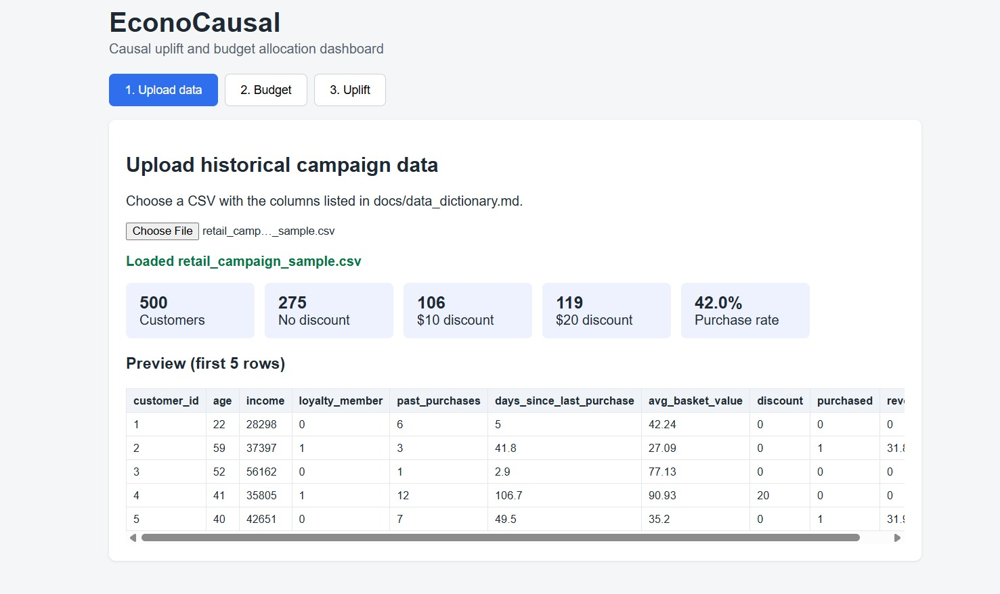
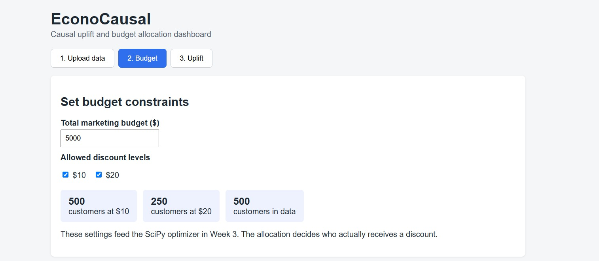
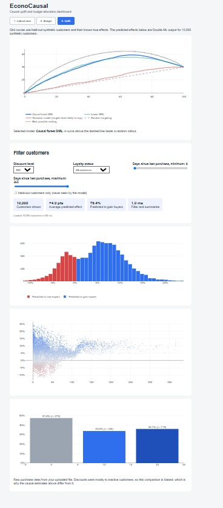
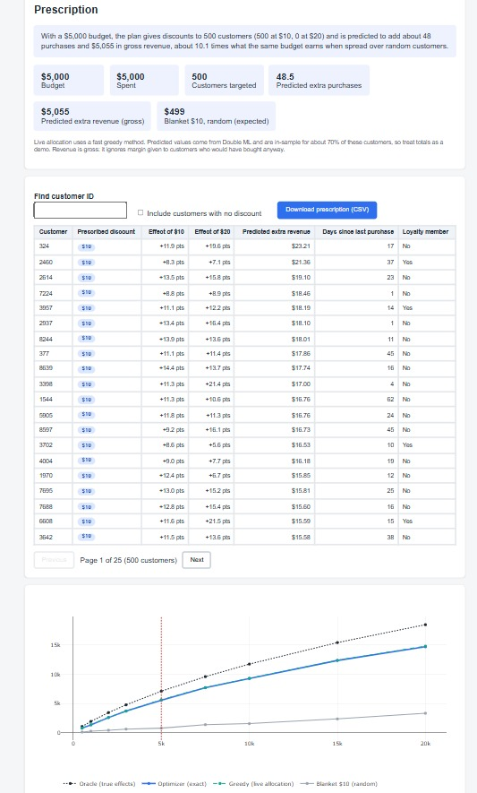

# EconoCausal: Dynamic Pricing via Double Machine Learning

Causal AI engine that estimates the **Individual Treatment Effect (ITE)** of a discount on each customer and allocates a fixed marketing budget only to "Persuadables".

## Problem
Standard ML predicts correlation, not causation. A model that flags a user as likely to churn may recommend a discount for someone who would have stayed anyway, wasting budget. EconoCausal answers: *"Would this user buy if and only if we gave them the discount?"*

## Key Modules
- **Causal Inference Engine** (Python, EconML, DoWhy): Double/Debiased ML for ITE estimation
- **Propensity Score Matching**: balances historical observational data
- **Optimization Solver** (SciPy): optimal discount allocation under a budget
- **Experimentation UI** (React, Plotly): uplift curves and allocation dashboard

## Week 1 Results
- Synthetic retail data (10,000 customers) with confounded discount assignment
- Causal DAG in DoWhy: confounders -> discount -> purchased
- The naive comparison makes a $20 discount look harmful (-0.097); backdoor adjustment gives +0.039 against a true average effect of +0.042
- Dashboard with Upload, Budget and Uplift views

See `docs/week1_summary.md` and `backend/notebooks/01_causal_walkthrough.ipynb`.

## Week 2 Results
- Propensity model (AUC 0.718) confirms discounts were not random; weighting cut the largest imbalance from 0.751 to 0.022
- Matching: 4,197 of 4,244 discounted customers matched; naive -0.084 became +0.047 against a true +0.049
- Double ML (EconML causal forest) on 3,000 held-out customers: correlation with true individual effects 0.82 ($10) and 0.71 ($20)
- Qini coefficient 0.72 for causal forest DML vs 0.08 for a standard purchase-prediction model
- Refutation tests: placebo near zero, random confounder and subsets stable; dropping the key confounder flips the estimate
- Dashboard shows real Qini curves and filters 10,000 predicted effects

Details: `docs/propensity_analysis.md`, `docs/matching_analysis.md`, `docs/dml_analysis.md`, `docs/refutation_analysis.md`, `docs/model_comparison.md`.

## Week 3 Results
- SciPy budget optimizer (exact integer program) chooses $0, $10 or $20 per customer to maximize predicted extra revenue within the budget
- On 3,000 held-out customers with a $1,500 budget (equal to $5,000 for 10,000 customers), targeting earned $1,667 of true extra revenue against $206 for random $10 discounts, and reached about 78% of the oracle ceiling ($2,128)
- Across budgets from $500 to $20,000 (per 10,000 customers), optimized targeting earned 4.4 to 8.1 times the extra revenue of random blanket discounts; greedy was within about 1% of the exact optimum
- The dashboard Allocation tab prescribes a discount for each of 10,000 customers for any budget, using a JavaScript greedy allocator tested against the Python version

Details: `docs/optimizer_analysis.md`, `docs/efficiency_analysis.md`.

## Project Structure
- `backend/src`: data generator, causal graph, propensity, matching, Double ML, refutation, model comparison
- `backend/notebooks`: experiments and analysis
- `backend/tests`: unit tests
- `data`: datasets (generated by scripts; only small samples are committed)
- `frontend`: React dashboard
- `docs`: DAG, assumptions, analyses, screenshots

## Setup
    python -m venv venv
    venv\Scripts\activate
    pip install -r backend/requirements.txt
    python backend\src\generate_data.py
    python backend\src\dml_engine.py
    python backend\src\model_comparison.py
    python backend\src\export_demo.py
    python -m pytest backend\tests -v

Optional analyses: `causal_graph.py`, `propensity.py`, `matching.py` and `refutation.py` in `backend/src`. The dashboard demo data is already committed in `frontend/public/demo`.

## Run the dashboard
    cd frontend
    npm install
    npm run dev

 ## Run the API
    python backend\src\train_final_model.py
    python -m uvicorn api:app --app-dir backend\src --port 8000

Open http://localhost:8000/docs for interactive documentation. Endpoints:
- `GET /health`: model status
- `POST /predict`: predicted effect of a $10 and a $20 discount per customer, with 90% intervals
- `POST /allocate`: discount prescription for a budget (`greedy` by default, `exact` is slower)

## Dashboard preview

## Progress
- [x] Week 1: Causal DAG (DoWhy) and dashboard scaffolding
- [x] Week 2: Double ML training, propensity score matching and uplift curves
- [ ] Mid Review: refutation tests and data load validation
- [x] Week 3: SciPy budget optimizer and allocation matrix UI
- [ ] Week 4: REST API, drift detector and final polish

