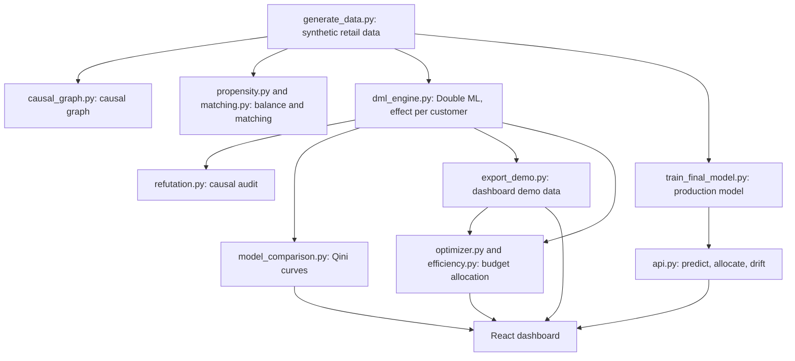

# Architecture

## Flow
1. `generate_data.py` creates 10,000 customers. Discounts are assigned in a confounded way (mostly to inactive, non-loyalty customers), and the true individual effects are saved separately for validation only.
2. The causal graph, propensity scores and matching show the confounding and correct for it on average.
3. Double ML (`dml_engine.py`) estimates the effect of each discount for each customer. It is trained on 70% of customers and evaluated on the remaining 30%.
4. `optimizer.py` chooses a discount per customer within a budget (exact integer program or fast greedy). `efficiency.py` repeats this across budgets.
5. `train_final_model.py` retrains on all customers and saves the model, with its reference data, for the API.
6. The dashboard shows the Qini curves and the allocation from files in `frontend/public/demo`, and calls the API's `/drift` endpoint for the data health check.

## Committed or generated
| Item | Status |
|---|---|
| Source code, tests, documents, screenshots | Committed |
| `data/retail_campaign_sample.csv` (500 rows) and the dashboard demo files in `frontend/public/demo` | Committed |
| Full datasets in `data/` | Generated by `run_pipeline.py` |
| `models/dml_forest.joblib` | Generated by `train_final_model.py` |

## Design choices
- **Greedy in the browser, exact in the API.** Greedy responds instantly and was within about 1% of the exact optimum on true revenue, so the dashboard uses it.
- **One model file holds the reference data.** The drift detector always compares with exactly what that model was trained on.
- **Fixed seeds everywhere**, so the pipeline reproduces the same results.