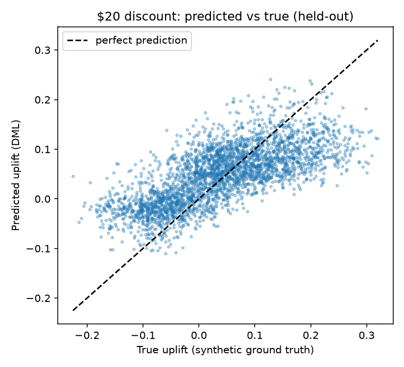
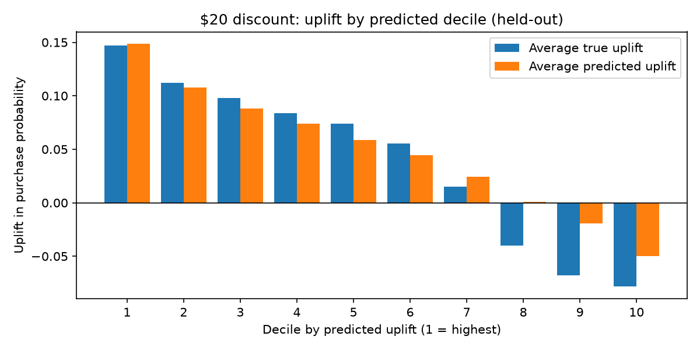

# Double ML Analysis (Week 2, Day 10)

- **Method:** EconML CausalForestDML, 5-fold cross-fitting
- **Nuisance models:** LightGBM regressor (outcome) and classifier (treatment)
- **Treatment:** discount in {0, 10, 20}, with 0 as the control
- **Outcome:** purchased (effects are on the probability scale)
- **Features:** age, income, loyalty_member, past_purchases, days_since_last_purchase
- **Split:** 7000 customers for training, 3000 held out for evaluation

## Held-out results

| Metric | $10 discount | $20 discount |
|---|---|---|
| Naive effect (raw data) | -0.073 | -0.097 |
| Mean predicted effect | +0.016 | +0.048 |
| Mean true effect | +0.028 | +0.040 |
| Correlation (predicted vs true) | 0.821 | 0.706 |
| RMSE | 0.045 | 0.075 |
| RMSE of always predicting the mean | 0.075 | 0.103 |
| Sign agreement | 84.3% | 82.2% |

## Uplift by predicted decile ($20, held-out)

| Decile | Avg predicted | Avg true |
|---|---|---|
| 1 | 0.148 | 0.147 |
| 2 | 0.108 | 0.112 |
| 3 | 0.088 | 0.098 |
| 4 | 0.074 | 0.084 |
| 5 | 0.059 | 0.074 |
| 6 | 0.044 | 0.055 |
| 7 | 0.024 | 0.015 |
| 8 | 0.001 | -0.040 |
| 9 | -0.019 | -0.068 |
| 10 | -0.050 | -0.078 |

## Notes
- Evaluation uses customers the model never saw. Comparison with true effects is possible only because the data is synthetic.
- Predictions are shrunk towards the middle: the lowest deciles are predicted less negative than they truly are.
- Unobserved confounding is not covered here. It is tested with the DoWhy refutation tests (see refutation_analysis.md).