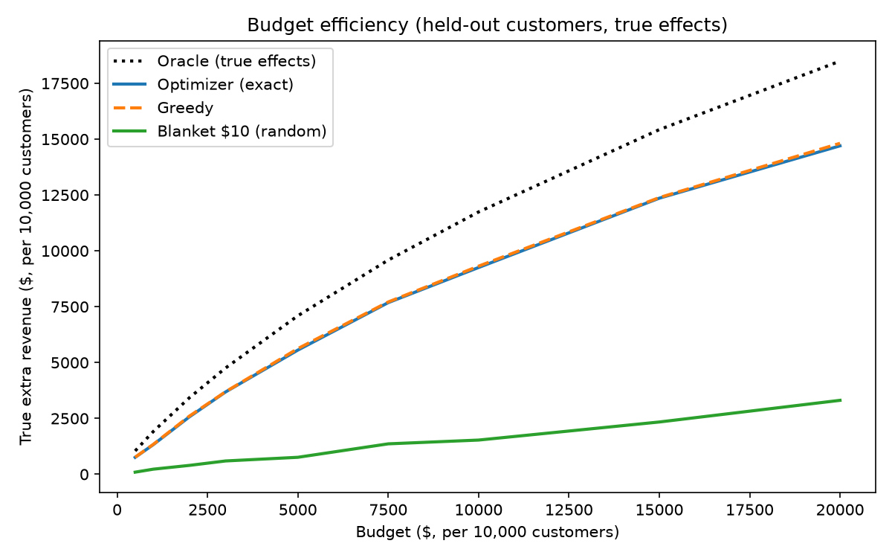

# Budget Efficiency Analysis (Week 3, Day 16)

Held-out customers (3,000), true effects from the synthetic ground truth,
scaled to a budget per 10,000 customers. Blanket is the average of 10 random
draws of $10 discounts.

| Budget | Optimizer | Greedy | Blanket | Oracle | Optimizer % of oracle | Optimizer vs blanket |
|---|---|---|---|---|---|---|
| $500 | $756 | $764 | $94 | $1,045 | 72.4% | 8.1x |
| $1,000 | $1,323 | $1,337 | $227 | $1,911 | 69.2% | 5.8x |
| $2,000 | $2,569 | $2,603 | $397 | $3,425 | 75.0% | 6.5x |
| $3,000 | $3,682 | $3,692 | $595 | $4,755 | 77.4% | 6.2x |
| $5,000 | $5,557 | $5,623 | $759 | $7,093 | 78.3% | 7.3x |
| $7,500 | $7,682 | $7,711 | $1,361 | $9,586 | 80.1% | 5.6x |
| $10,000 | $9,254 | $9,314 | $1,530 | $11,741 | 78.8% | 6.0x |
| $15,000 | $12,356 | $12,384 | $2,339 | $15,426 | 80.1% | 5.3x |
| $20,000 | $14,701 | $14,814 | $3,309 | $18,493 | 79.5% | 4.4x |

## Findings
- Targeting by predicted effect earns between 4.4 and 8.1 times the extra revenue of random blanket discounts at every budget.
- The optimizer reaches about 78 to 80% of the oracle ceiling (perfect knowledge of true effects) for budgets of $3,000 and above.
- Greedy was within 0.2 to 1.3% of the exact optimizer and ahead of it on true revenue at every budget. On predicted values the exact solver is slightly better, so part of its edge is fitting prediction noise. The live dashboard therefore uses greedy.
- Returns diminish: extra revenue per extra budget dollar falls from about 1.1 to 1.25 (budgets up to $3,000) to 0.94 (to $5,000), 0.85 (to $7,500) and 0.47 (from $15,000 to $20,000).

## Limits
- Revenue is gross: it ignores margin given to customers who would have bought anyway, so the figures are not profit and the diminishing-returns thresholds are not break-even points.
- True effects exist only because the data is synthetic. Real data would need a randomized holdout group.
- One held-out set and one model fit: differences of about 1% (greedy vs optimizer) may be noise.
- The dashboard's predicted totals use all 10,000 customers, 70% of them in-sample, so they are not directly comparable to this table.