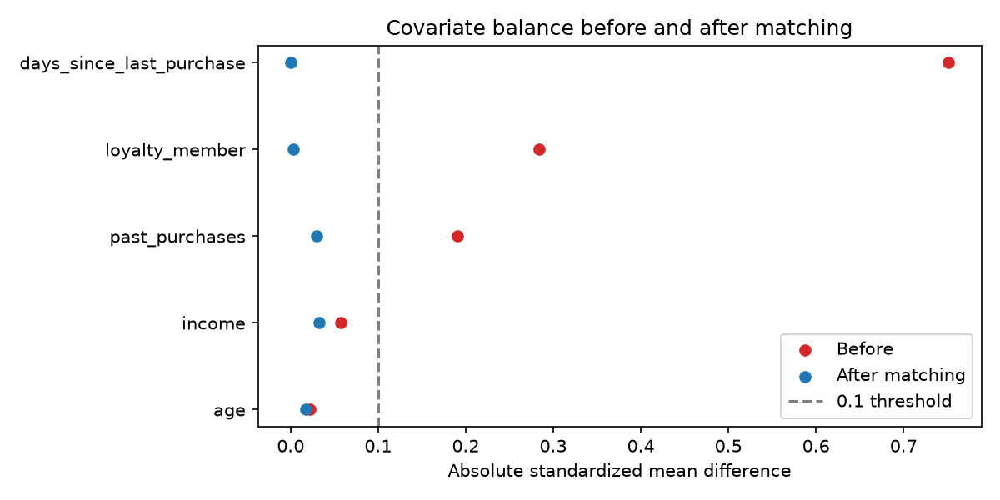

# Propensity Score Matching (Week 2, Day 9)

- **Method:** 1:1 nearest-neighbour matching with replacement on logit(propensity), caliper 0.2 standard deviations
- **Treated customers:** 4244
- **Matched pairs:** 4197 (dropped by caliper: 47)
- **Unique controls used:** 2240 of 5756 (max reuse: 36)

## Balance (standardized mean difference)

| Covariate | Before | After matching |
|---|---|---|
| age | 0.023 | 0.018 |
| income | -0.057 | -0.033 |
| loyalty_member | -0.284 | -0.003 |
| past_purchases | -0.190 | 0.029 |
| days_since_last_purchase | 0.751 | -0.000 |

## Effect of receiving a discount (effect on the treated)

| Estimate | Value |
|---|---|
| Naive difference | -0.084 |
| Matched ATT (95% CI) | +0.047 (+0.028 to +0.066) |
| True ATT (synthetic ground truth) | +0.049 |

## Notes
- Matching balances observed covariates only; unobserved confounding is tested with DoWhy refutation tests at the Mid Review.
- The confidence interval is approximate because controls are reused.
- This estimates one average effect for "any discount". Per-customer and per-level effects ($10 vs $20) come from Double ML.