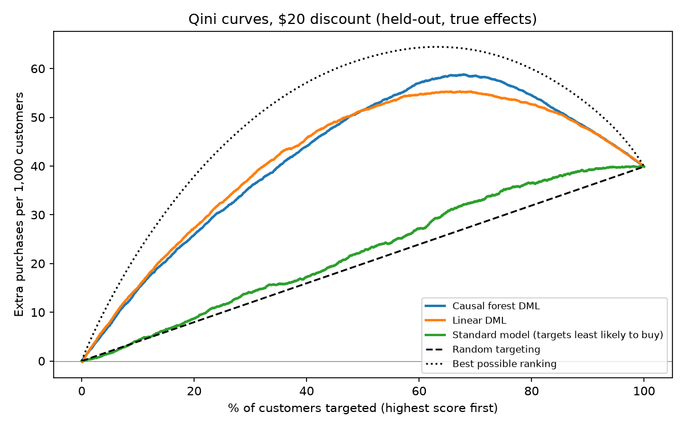

# Model Comparison and Qini Curves (Week 2, Day 12)

Held-out customers: 3000 (same split as Day 10). Average true uplift of a
$20 discount if everyone is targeted: +0.040.

| Strategy | Qini coefficient | Avg uplift, top 10% | Top 30% | Top 50% |
|---|---|---|---|---|
| Causal forest DML | 0.721 | 0.147 | 0.119 | 0.103 |
| Linear DML | 0.715 | 0.151 | 0.126 | 0.103 |
| Standard model (targets least likely to buy) | 0.078 | 0.042 | 0.047 | 0.045 |
| Best possible ranking (ceiling) | 1.000 | 0.223 | 0.164 | 0.124 |

- The causal forest predicts a positive effect for 75.4% of customers; their average true uplift is +0.075.
- Linear DML predicts a positive effect for 69.8%; their average true uplift is +0.079.

## Final model
Causal forest DML. Qini coefficients of the two DML models differ by only
0.006, so accuracy does not separate them. The forest is preferred because
it provides valid confidence intervals, which the linear variant does not.

## Interpretation
- Both DML models rank customers far better than a standard purchase-prediction model, which is close to random targeting for this problem.
- Qini coefficient: 0 means no better than random targeting, 1 means the best possible ranking.

## Notes
- Curves use the true individual effects from the synthetic ground truth, so this evaluation is only possible on synthetic data. With real data a randomized holdout group would be needed.
- Curve data is exported to frontend/public/demo/qini_curves.json for the dashboard.