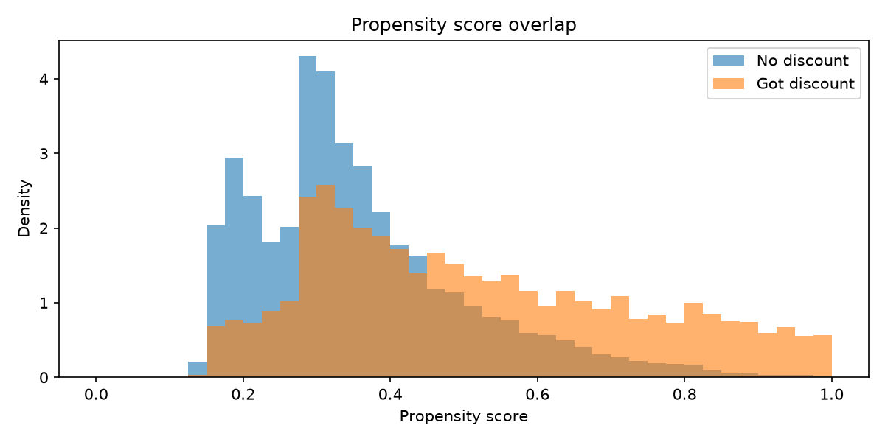
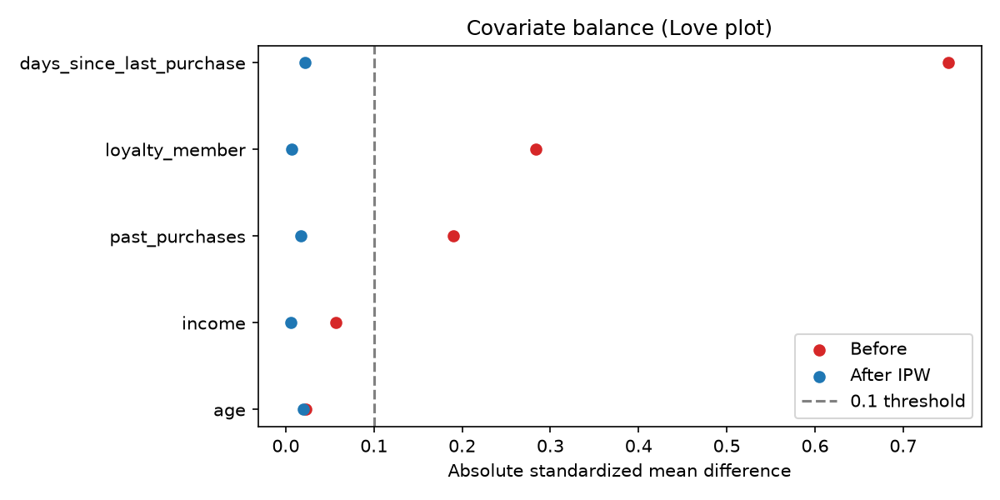

# Propensity Score Analysis (Week 2, Day 8)

- **Treatment (binary):** any discount vs none (42.4% of customers treated)
- **Model:** logistic regression on the five confounders, 5-fold cross-fitted
- **AUC:** 0.718
- **Largest imbalance before weighting:** days_since_last_purchase (SMD 0.751)

- **Largest imbalance after IPW:** days_since_last_purchase (|SMD| 0.022), down from 0.751
- **Effective sample size after IPW:** 6726 of 10000
- **Overlap:** treated scores 0.128 to 0.990, untreated 0.127 to 0.984

| Covariate | SMD before | SMD after IPW |
|---|---|---|
| age | 0.023 | 0.020 |
| income | -0.057 | 0.006 |
| loyalty_member | -0.284 | 0.007 |
| past_purchases | -0.190 | 0.017 |
| days_since_last_purchase | 0.751 | -0.022 |

## Notes
- Cross-fitting avoids overfitting the propensity scores to the same rows.
- Balance is checked on observed covariates only. Unobserved confounding
  is tested later with DoWhy refutation tests.
- The multi-level treatment ($10 vs $20) is handled by Double ML.