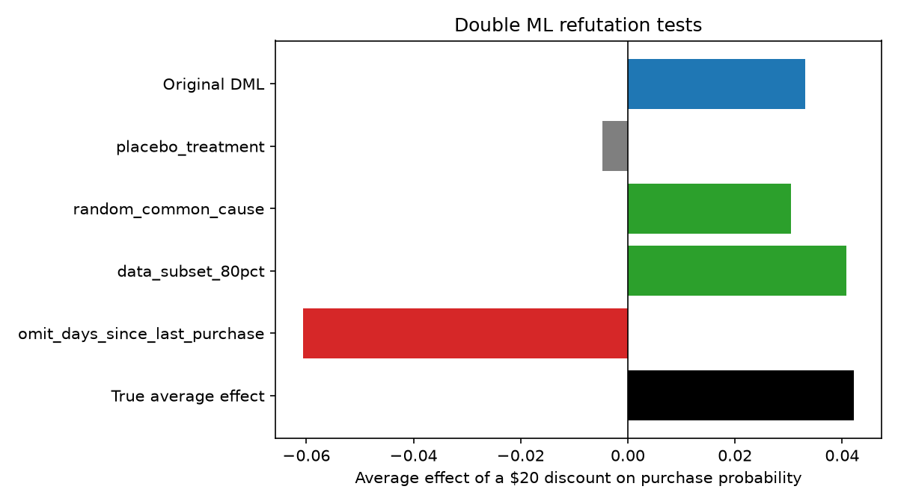

# Causal Audit: Refutation Tests (Week 2, Day 11)

## Part A: DoWhy refuters ($20 discount vs none, linear backdoor estimator)

| Test | Original effect | After test | p-value |
|---|---|---|---|
| Placebo treatment (permuted) | +0.036 | +0.005 | 0.315 |
| Random common cause | +0.036 | +0.036 | 0.461 |
| Data subset (80%) | +0.036 | +0.038 | 0.325 |

True average effect for these customers (synthetic ground truth): +0.039

## Part B: Double ML (LinearDML, LightGBM nuisance models)

| Test | Average effect of a $20 discount |
|---|---|
| Original | +0.033 (true +0.042) |
| Placebo treatment (3 repeats) | -0.005 |
| Random common cause (3 repeats) | +0.030 |
| Data subset 80% (3 repeats) | +0.041 |
| Omit days_since_last_purchase | -0.061 |

## Interpretation
- The placebo effect is near zero, and adding a random confounder or using a subsample barely changes the estimate. These tests found no problem.
- Dropping the strongest confounder flips the sign of the estimate, which shows how a hidden confounder of that strength would bias the result undetected.
- The tests support the estimate. They cannot prove that no unobserved confounder exists.

## Notes
- Pass thresholds in Part B are rough rules of thumb, not statistical standards.
- Estimates vary by about 0.01 between runs.
- econml warns that the covariance matrix is underdetermined (likely collinear polynomial terms). This affects confidence intervals, not the point estimates used here.